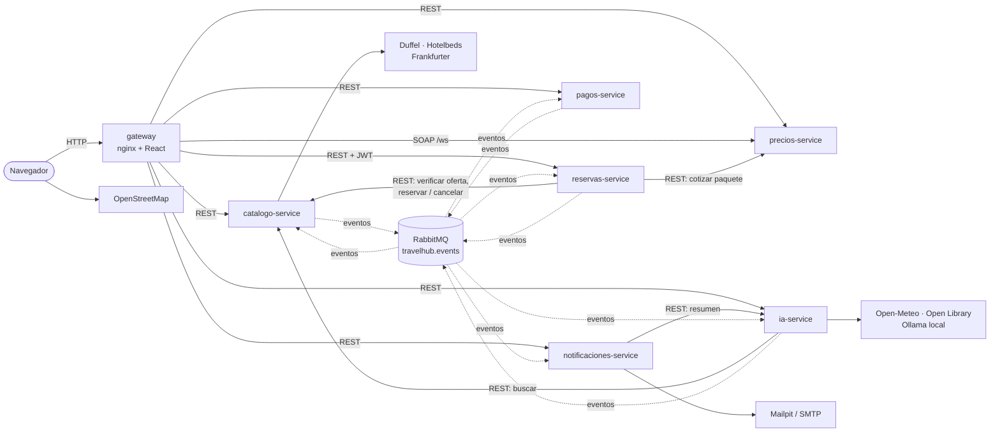
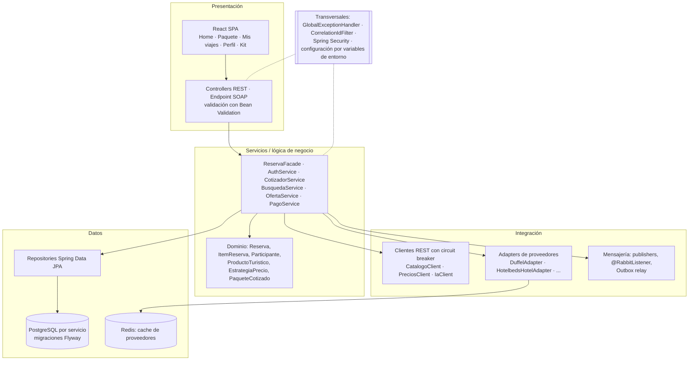
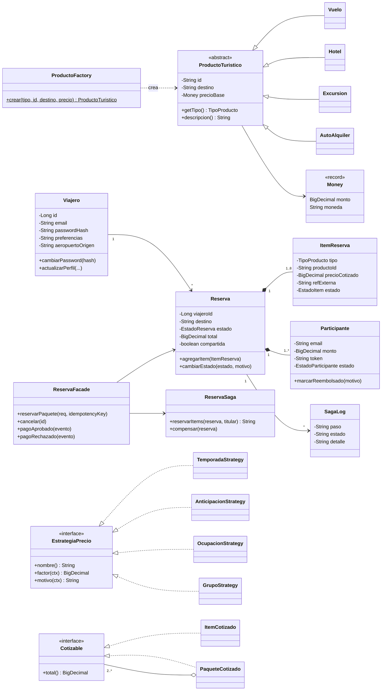
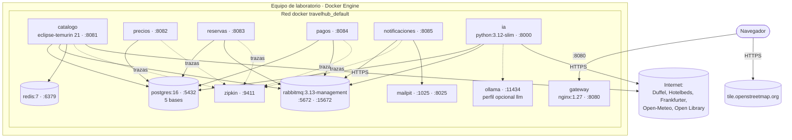

# 2. Informe de arquitectura

## 2.1 Resumen
TravelHub es un sistema de **microservicios ligeros** con integración **sincrónica** (REST y SOAP) y **asincrónica**
(eventos en RabbitMQ). Cada servicio tiene su propia base de datos (*database per service*), se despliega en su
propio contenedor y se comunica con los demás solo por contratos publicados (OpenAPI, WSDL o eventos).
Un **gateway** (nginx) es el único punto de entrada para el navegador.

| Servicio | Tecnología | Responsabilidad | Base | Puerto |
|---|---|---|---|---|
| gateway | nginx + React (Vite) | Sirve el frontend y enruta `/api/*` y `/ws` | — | 8080 |
| catalogo-service | Spring Boot 3.3 | Búsqueda en proveedores (Adapter), ofertas verificables, autos propios, tipo de cambio | `catalogo_db` + Redis | 8081 |
| precios-service | Spring Boot 3.3 + Spring WS | Cotización dinámica (Strategy) y de paquetes (Composite). **REST y SOAP** | `precios_db` | 8082 |
| reservas-service | Spring Boot 3.3 + Spring Security | Viajeros y login, reservas (Facade), **Saga**, viaje compartido, créditos, alertas, Outbox | `reservas_db` | 8083 |
| pagos-service | Spring Boot 3.3 | Cobros y reembolsos asincrónicos (Strategy de procesador) | `pagos_db` | 8084 |
| notificaciones-service | Spring Boot 3.3 | Mails (SMTP: Mailpit o Gmail) con resumen generado por la IA | — | 8085 |
| ia-service | Python 3.12 + FastAPI + scikit-learn | Anomalías, resumen con LLM, recomendaciones, asistente, kit de viaje | `ia_db` | 8000 |
| Infraestructura | PostgreSQL 16, RabbitMQ, Redis, Zipkin, Mailpit, Ollama (opcional) | | | |

## 2.2 Diagrama de componentes

Interfaces que expone cada componente:
- **REST** documentado con OpenAPI en `/swagger-ui.html` (Java) y `/docs` (IA). Ver [04_INTEGRACION.md](04_INTEGRACION.md).
- **SOAP**: `precios-service` publica `CotizarProducto` y `CotizarPaquete` en `/ws` con WSDL generado desde `cotizacion.xsd`.
- **Eventos**: 11 routing keys en el exchange `travelhub.events`.

## 2.3 Arquitectura en capas
Todos los servicios Java siguen las mismas capas. Las dependencias van siempre hacia abajo.

| Capa | Responsabilidad | Ejemplo en reservas-service |
|---|---|---|
| Presentación | Recibir el request, validar formato, traducir a/desde DTOs. Sin lógica de negocio | `ReservaController`, `ReservaDtos` |
| Servicios | Reglas de negocio y orquestación; transacciones | `ReservaFacade`, `ReservaSaga`, `AuthService` |
| Dominio | Entidades con su comportamiento y estados | `Reserva.cambiarEstado`, `Participante.marcarReembolsado` |
| Integración | Hablar con otros servicios y sistemas externos | `CatalogoClient`, `ReservasEventPublisher`, `OutboxRelay` |
| Datos | Persistencia | `ReservaRepository`, `V1..V4__*.sql` |

## 2.4 Componentes reutilizables (`travelhub-common`)
Módulo Maven que usan todos los servicios Java. Se versiona con el proyecto y no depende de ningún servicio.

| Componente | Paquete | Contenido | Quién lo usa |
|---|---|---|---|
| **Dominio** | `common.domain`, `common.factory`, `common.events` | `ProductoTuristico` y sus subclases, `Money`, `TipoProducto`, `ProductoFactory`, los 11 eventos de integración | Todos |
| **Utilidad** | `common.web`, `common.util` | Manejo de errores uniforme (`GlobalExceptionHandler`, `ApiError`), logging con `CorrelationIdFilter`, `ValidadorFechas`, firma de Hotelbeds | Todos |
| **Configuración de mensajería** | `common.messaging` | Exchange, DLX/DLQ, conversor JSON y reintentos (`MensajeriaConfig`) | Todos los que usan RabbitMQ |
| **Acceso a datos** | En cada servicio (ej. `reserva/ReservaRepository`) | Repositories de Spring Data JPA (patrón Repository) | Cada servicio el suyo |

**Decisión sobre el acceso a datos:** el componente de acceso a datos no está en el módulo común a propósito.
Con *database per service*, cada servicio es dueño de su esquema; un DAO compartido acoplaría los esquemas y
obligaría a desplegar todo junto ante cualquier cambio. Lo que sí se comparte es el patrón (interfaces
`JpaRepository`) y la convención (migraciones Flyway versionadas).

## 2.5 Diagrama de clases (núcleo del dominio)

Estados: `EstadoReserva` = PENDIENTE, PAGADA, CONFIRMADA, CANCELADA, FALLIDA · `EstadoItem` = PENDIENTE, RESERVADO,
CANCELADO, FALLIDO · `EstadoParticipante` = PENDIENTE, PROCESANDO, PAGADO, RECHAZADO, REEMBOLSADO, CANCELADO.

## 2.6 Diagrama de despliegue

- Un comando levanta todo: `docker compose up -d --build`. Los servicios esperan a Postgres y RabbitMQ (*healthchecks*).
- Configuración externalizada: variables de entorno con valores por defecto para desarrollo (`.env.example`).
- `restart: unless-stopped`: si un servicio se cae, Docker lo levanta y los mensajes lo esperan en su cola.
- Manual paso a paso: [GUIA_INSTALACION.md](GUIA_INSTALACION.md).

## 2.7 Acceso local vs remoto entre componentes
`precios-service/.../InvocacionLocalVsRemotaTest` cotiza lo mismo de tres formas y compara (50 llamadas):

| Forma | Cómo | Tiempo promedio |
|---|---|---|
| Local | Llamada directa a `CotizadorService` en la misma JVM | 0,13 ms |
| Remota REST/JSON | `POST /api/precios/cotizar` por HTTP | 17,6 ms |
| Remota SOAP/XML | `CotizarProducto` en `/ws` por HTTP | 18,7 ms |

El resultado es idéntico en los tres casos (el test lo verifica). La invocación remota cuesta dos órdenes de magnitud
más (serialización, red, HTTP), pero permite desplegar, escalar y versionar cada componente por separado. Por eso
dentro de un servicio se usa invocación directa y entre servicios, interfaces remotas.

## 2.8 Decisiones de arquitectura
| Decisión | Alternativa descartada | Por qué |
|---|---|---|
| Microservicios con base propia | Monolito modular | La consigna pide SOA/microservicios; permite fallas aisladas y despliegue independiente |
| RabbitMQ (topic exchange) | Kafka | Enrutamiento por routing key, DLQ nativa y consola de administración; el volumen no justifica Kafka |
| Saga orquestada en reservas | Transacción distribuida (2PC) | Los proveedores externos no soportan 2PC; la compensación es explícita y queda en la bitácora |
| Outbox para publicar eventos | Publicar directo después del commit | Si RabbitMQ está caído el evento no se pierde |
| Precio verificado en el servidor | Confiar en el precio que manda el navegador | Evita que el usuario reserve con un precio adulterado |
| SOAP solo en precios | SOAP en todos | Cotizar es el servicio más probable de exponer a socios B2B; el resto se consume desde la web |
| Gateway nginx | Spring Cloud Gateway | Más liviano; además sirve el frontend |
| IA en Python | IA en Java | scikit-learn y el ecosistema de ML; se integra igual por REST y por la cola |
| LLM local (Ollama) opcional | API de OpenAI | Privacidad (ningún dato sale del equipo) y costo cero; con plantilla de respaldo |
| JWT HS256 emitido por reservas | Keycloak | Un solo emisor y validador; menos piezas para el laboratorio |
