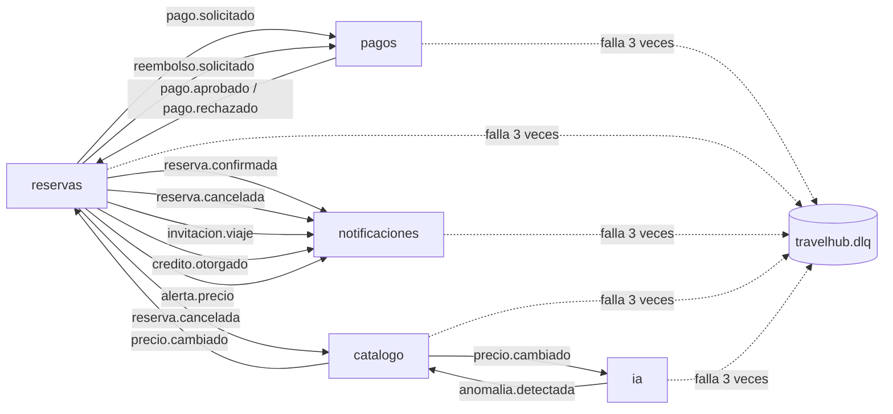
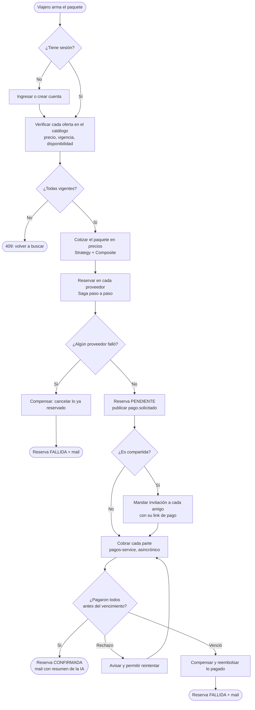
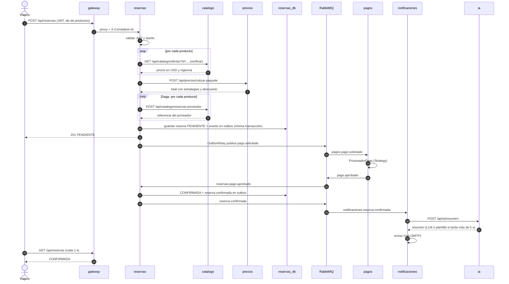
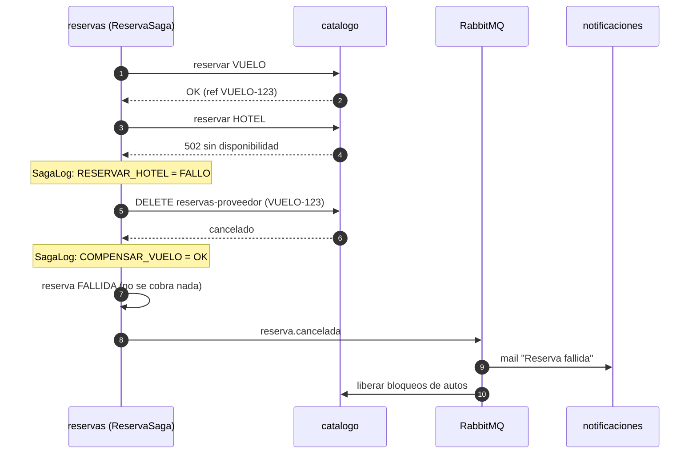
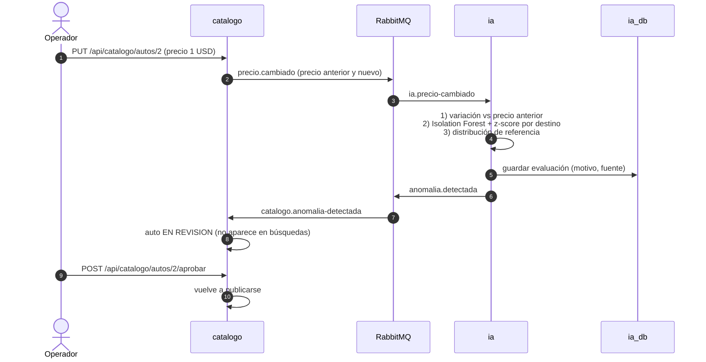
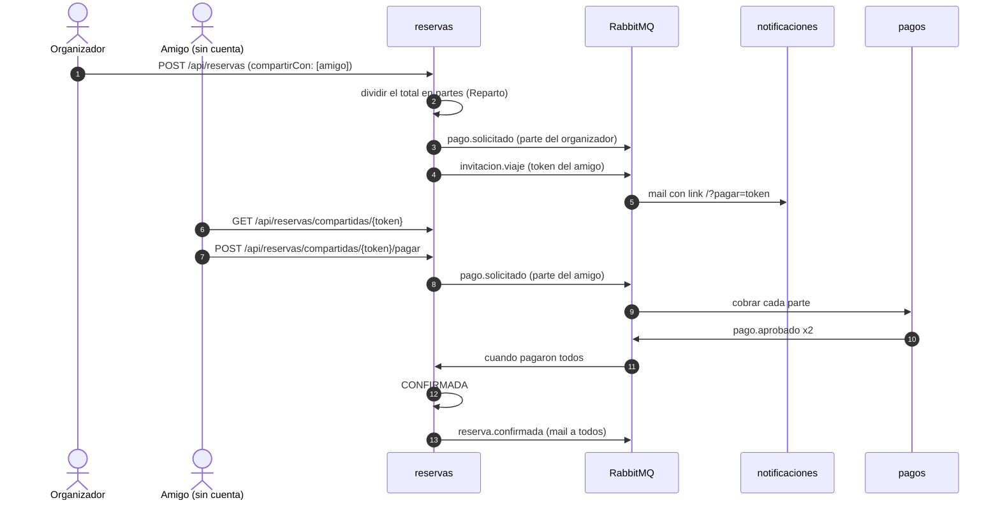

# 4. Integración: contratos, mensajería y procesos

## 4.1 Contratos REST (OpenAPI)
Los contratos exportados están en [`docs/contratos/`](contratos/). Con el sistema levantado también se pueden
probar desde Swagger UI.

| Servicio | Contrato | Swagger UI | Operaciones principales |
|---|---|---|---|
| catalogo | [openapi-catalogo.json](contratos/openapi-catalogo.json) | http://localhost:8081/swagger-ui.html | `GET /api/catalogo/buscar`, `GET /ofertas` (verificar), `POST/DELETE /reservas-proveedor`, CRUD de autos, aprobar ofertas bloqueadas |
| precios | [openapi-precios.json](contratos/openapi-precios.json) | http://localhost:8082/swagger-ui.html | `POST /api/precios/cotizar`, `POST /api/precios/cotizar-paquete` |
| reservas | [openapi-reservas.json](contratos/openapi-reservas.json) | http://localhost:8083/swagger-ui.html | `/api/auth/*`, `/api/viajeros/me`, `POST/GET/DELETE /api/reservas`, viaje compartido, créditos, seguimientos |
| pagos | [openapi-pagos.json](contratos/openapi-pagos.json) | http://localhost:8084/swagger-ui.html | `GET /api/pagos` (consulta; los cobros entran por la cola) |
| notificaciones | [openapi-notificaciones.json](contratos/openapi-notificaciones.json) | http://localhost:8085/swagger-ui.html | `GET /api/notificaciones` (últimos envíos), `POST /prueba` |
| ia | [openapi-ia.json](contratos/openapi-ia.json) | http://localhost:8000/docs | anomalías, resumen, recomendaciones, asistente, kit |

**Convenciones**
- JSON, fechas ISO-8601, montos en USD con 2 decimales.
- Errores con un formato único (`ApiError`): `status`, `error`, `mensaje`, `correlationId`, `timestamp`, `detalles`.
  400 datos inválidos · 401 sin sesión · 403 recurso ajeno · 404 no existe · 409 conflicto (ej. oferta vencida) · 502 falla de un proveedor.
- Las rutas de reservas, créditos, seguimientos y perfil piden `Authorization: Bearer <JWT>` (ver [PR_LOGIN.md](PR_LOGIN.md)).
- `POST /api/reservas` acepta `Idempotency-Key`.

## 4.2 Contrato SOAP
- **Servicio:** `precios-service`, endpoint `http://localhost:8082/ws` (también por el gateway en `:8080/ws`).
- **WSDL:** http://localhost:8082/ws/cotizacion.wsdl · copia en [contratos/cotizacion.wsdl](contratos/cotizacion.wsdl).
- **Esquema (contrato primero):** [contratos/cotizacion.xsd](contratos/cotizacion.xsd). El WSDL se genera a partir del XSD.
- **Namespace:** `http://travelhub.com/precios/soap`

| Operación | Request | Response |
|---|---|---|
| `CotizarProducto` | `item`: tipoProducto, precioBase, moneda, fechaInicio, fechaFin, pasajeros, ocupacion | precio final y desglose de factores (`estrategia`, `factor`, `motivo`) |
| `CotizarPaquete` | lista de `item` | total por ítem, subtotal, descuento y total del paquete |

Errores: un dato inválido devuelve un `SOAP-ENV:Fault` con `faultcode` `Client` y el motivo (ej. "precioBase debe ser positivo").
Ejemplos listos para SoapUI o Postman: [`tests/soap/`](../tests/soap/).

## 4.3 Mensajería
**Broker:** RabbitMQ 3.13 · **exchange:** `travelhub.events` (tipo *topic*, durable) · **dead letter:** exchange `travelhub.dlx` → cola `travelhub.dlq`.
La tabla completa de eventos, colas y consumidores está en el [README](../README.md#eventos).

### Configuración de colas
| Parámetro | Valor | Dónde |
|---|---|---|
| Colas | Durables, una por consumidor (`<servicio>.<evento>`) | `*RabbitConfig` de cada servicio |
| Formato | JSON (`Jackson2JsonMessageConverter`) | `MensajeriaConfig` |
| Reintentos | 3 intentos, backoff de 1 s multiplicado por 2 | `spring.rabbitmq.listener.simple.retry` |
| Mensaje que sigue fallando | No se reencola: va a `travelhub.dlx` → `travelhub.dlq` | `x-dead-letter-exchange` en cada cola |
| Publicación desde reservas | Outbox: tabla `outbox_evento`, relay cada 1 s, en orden | `OutboxRelay` |
| Consumidor Python (ia) | `pika`, `basic_nack(requeue=False)` ante error → DLQ | `ia-service/app/mensajeria.py` |
| Trazas | El `traceId` viaja en los headers del mensaje (Micrometer) | `observation-enabled: true` |

### Flujo de mensajes

## 4.4 Proceso de negocio: reservar un paquete (BPMN simplificado)

## 4.5 Diagramas de secuencia

### Reserva exitosa (sincrónico + asincrónico)

### Falla de un proveedor: compensación (Saga)

### Detección de anomalías (IA asincrónica)

### Viaje compartido

## 4.6 Integración con terceros
| Tercero | Uso | Tipo | Si falla |
|---|---|---|---|
| Duffel | Vuelos reales (modo `real`) | REST + token | Circuit breaker y vuelve a datos simulados |
| Hotelbeds Hotels / Activities | Hoteles y excursiones reales | REST con firma SHA-256 | Circuit breaker y vuelve a datos simulados |
| Frankfurter | Tipo de cambio a USD | REST, sin clave | Circuit breaker y cache |
| Open-Meteo | Clima del destino para el kit y las recomendaciones | REST, sin clave | El kit sale sin clima |
| Open Library | Libros sobre el destino | REST, sin clave | Lista de respaldo |
| OpenStreetMap | Mapa base del kit de viaje | Teselas desde el navegador | Aviso; el itinerario se ve igual |
| Ollama (local) | LLM para el resumen y el asistente | REST local | Plantilla / reglas |
| SMTP (Mailpit o Gmail) | Envío de mails | SMTP | El mensaje va a la DLQ tras 3 intentos |
