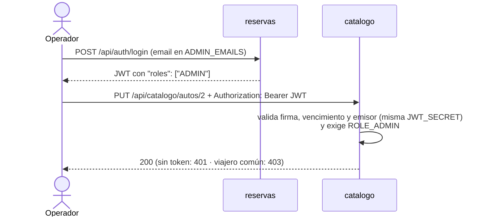

# PR: Rol ADMIN para las operaciones de operador del catálogo

## Por qué
Cambiar el precio de un auto, darlo de alta o de baja y aprobar lo que bloqueó la IA eran operaciones públicas:
cualquiera podía hacerlas a través del gateway sin ingresar. Además, reservar y cancelar en los proveedores
(`/api/catalogo/reservas-proveedor`), que solo usa `reservas-service`, también se podía llamar desde afuera.

## Cómo funciona


| Qué | Dónde | Detalle |
|---|---|---|
| Rol en el token | `reservas/seguridad/TokenService` | Claim `roles`: `["ADMIN"]` si el email está en `ADMIN_EMAILS`, `[]` si no. El login también lo devuelve en `roles` |
| Validación en el catálogo | `catalogo/seguridad/SeguridadConfig` | El catálogo no tiene usuarios: valida el JWT de reservas con la misma clave y convierte `roles` en `ROLE_ADMIN` |
| Operaciones protegidas | `AutoController`, `OfertaController` | `POST/PUT/DELETE /api/catalogo/autos/**`, `POST /api/catalogo/ofertas/aprobar`, `GET /api/catalogo/ofertas/bloqueadas` |
| Operación interna | `gateway/nginx.conf` | `/api/catalogo/reservas-proveedor` responde 403 desde afuera; `reservas` lo sigue usando por la red de Docker |
| Swagger | `OpenApiSeguridad` | Botón *Authorize* y candado en las operaciones de operador |

## Qué sigue igual
- **Buscar, ver autos, verificar ofertas y el tipo de cambio** siguen siendo públicos.
- El frontend manda el token en todas las llamadas: en las rutas públicas del catálogo se ignora, así que una sesión vencida nunca rompe una búsqueda.
- La Saga sigue reservando en los proveedores igual (llamada interna, sin pasar por el gateway).

## Configuración
```env
ADMIN_EMAILS=admin@travelhub.local      # separados por coma
```
Quien ingrese con uno de esos emails tiene el rol ADMIN. Para la demo, `docker-compose.yml` usa `admin@travelhub.local`;
en un entorno real conviene poner el email de cada operador. La primera vez hay que crear la cuenta con `/api/auth/registro`.

## Decisiones
- **Lista de admins por configuración** y no una columna en la base: no hace falta una pantalla para gestionar roles y no se puede "ascender" a alguien con un request.
- **El catálogo solo valida, no emite**: un único emisor de tokens (reservas) y una clave compartida. Si más servicios lo necesitaran se pasaría a RS256 (clave pública).
- **Bloqueo en el gateway para la operación interna** en vez de autenticación entre servicios: la llamada viaja solo por la red interna de Docker.

## Pruebas
| Test | Qué verifica |
|---|---|
| `SeguridadCatalogoWebTest` (9) | 401 sin token, 403 con un viajero, 200 con ADMIN, token con otra clave rechazado aunque diga ADMIN, buscar sigue público, un token vencido no rompe la búsqueda |
| `TokenServiceTest` (+2) | El token del operador lleva `roles: ["ADMIN"]`; el de un viajero, `[]` |
| `tests/e2e/prueba_funcional.py` (+8) | Con el sistema levantado: 401/403/200 al cambiar precios, la demo de anomalías con el operador, aprobación y el bloqueo del gateway |

## Cómo probar
1. `docker compose up -d --build`.
2. `tests/http/demo.http` pasos 7a a 8b: ingresar como operador, ver que un viajero recibe 403, cargar el auto a 1 USD con el token de operador y aprobarlo después de que la IA lo marque.
3. Swagger del catálogo (http://localhost:8081/swagger-ui.html): *Authorize* con el token del operador.
